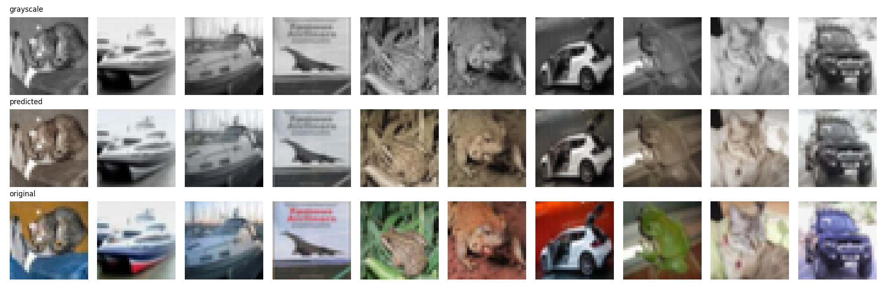

# Image Colorization with a U-Net (PyTorch)

A small U-Net that takes a grayscale image and predicts its colors. Trained on CIFAR-10 and checked against a plain grayscale baseline on all 10,000 test images.



## How it works

1. Convert RGB images to LAB color space. `L` is brightness (the grayscale picture), `a` and `b` are the colors.
2. Feed `L` into a U-Net and predict `a` and `b`.
3. Put the predicted `a`, `b` back with the original `L` and convert to RGB.

Things that mattered:
- Inputs and targets are scaled to about -1..1 and the output layer is `tanh`, so the ranges match.
- L1 loss instead of MSE, which gives less washed out colors.
- A validation split is used to pick the best epoch. The test set is only used once at the end.
- Results are compared with a "do nothing" baseline (grayscale), not just shown as pictures.

## Results
 
Scores on the 10,000 CIFAR-10 test images:

| Metric | Grayscale baseline | U-Net |
|---|---|---|
| PSNR (dB) | 24.81 | 25.34 |
| SSIM | 0.931 | 0.938 |
| Mean abs error (a, b) | 9.29 | 7.82 |

The U-Net beats the grayscale baseline on 69.7% of the test images and cuts the color error by about 16%. The PSNR and SSIM gains look small because CIFAR-10 pictures are already fairly muted, so grayscale scores high to begin with. The color error is the fairest number for what the model learned.

Validation loss was lowest at epoch 14 and went up slightly after that while training loss kept falling (mild overfitting). The scores above use the weights from the best epoch.

## Run it

```
pip install -r requirements.txt
jupyter notebook AI_colorizer_pytorch.ipynb
```

Or open the notebook in Google Colab and switch the runtime to a GPU. The dataset downloads on the first run. On a T4 GPU the full notebook takes around 15 to 20 minutes.

## Files

- `AI_colorizer_pytorch.ipynb`: the full project, from data to evaluation
- `results.png`: grayscale, predicted and original images side by side
- `requirements.txt`: Python packages

## Limitations

- The images are 32x32, so the output is small and a bit soft.
- Colorization is ambiguous (a shirt can be any color), so the model tends to pick safe, muted colors.
- Only trained on CIFAR-10.

## Ideas for later

- Random flips (augmentation) to reduce overfitting
- Bigger images and a larger dataset
- GAN or perceptual loss for more vivid colors
- Predict colors as classes instead of regression

